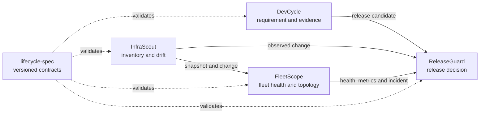

# AI DevOps Open Suite


## v2 development and licensing

Stable: v1.x (historical Apache-2.0 releases). Preview: v2.0.0-rc.1 AI Engineering Team Community; not GA. The public stable installer remains v1.x; use the explicit RC offline release for these Runtime and security updates; see [known release boundaries](docs/v2-known-risks.md).

Community Edition: **AGPL-3.0-only** for this development source. Historical release rights remain valid.
Commercial / OEM licensing available for closed-source redistribution, white-labeling, embedding and other use cases incompatible with AGPL. See [license policy](LICENSE_POLICY.md), [history](LICENSING_HISTORY.md) and [commercial policy](COMMERCIAL_LICENSE.md).


A local-first, low-configuration open source suite that connects what a team intended to build, what changed in code and infrastructure, how a fleet is behaving, and whether a release is ready to proceed.

[](https://github.com/GeneJie199/ai-devops-open-suite/actions/workflows/ci.yml)
[](LICENSE)

## Screenshot

| DevCycle | InfraScout |
|---|---|
|  |  |

| FleetScope | ReleaseGuard |
|---|---|
|  |  |

## Why

Small teams should not have to assemble a project tracker, machine inventory, collector, dashboard, topology engine, release gate, and several glue services before they can answer basic delivery questions. Open Suite gives each concern a focused standalone product and connects them through versioned evidence, while keeping data local and AI optional.

## Core Features

- **DevCycle** turns one requirement into editable scope, acceptance criteria, agent tasks, human-readable Git impact, test evidence, and a release candidate.
- **InfraScout** performs useful zero-configuration Linux discovery, database metadata inspection, baseline/drift review, and release-ready evidence without reading business rows.
- **FleetScope** owns its native Agent, collector, bounded telemetry/event stores, alerting, resource groups, monitoring coverage, changes, and evidence-backed topology.
- **ReleaseGuard** runs deterministic preflight and observation gates, correlates expected changes, verifies rollback readiness, and binds the final decision to an immutable report.
- **lifecycle-spec** keeps every cross-product document portable and independently validatable.
- One installer provides checksums, backups, interrupted-upgrade recovery, rollback, doctor, start/stop, safe uninstall, and explicit purge.

## Quick Start

Windows PowerShell:

```powershell
irm https://raw.githubusercontent.com/GeneJie199/ai-devops-open-suite/main/scripts/bootstrap.ps1 | iex
```

Linux or macOS:

```bash
curl -fsSL https://raw.githubusercontent.com/GeneJie199/ai-devops-open-suite/main/scripts/bootstrap.sh | bash
```

The bootstrap downloads the latest stable suite archive and checksum, verifies SHA-256, installs all components, initializes secure local state, starts the suite, and runs `doctor`. Services listen on `127.0.0.1` by default.

## Online Install

The commands above are the supported online path. They download one stable bootstrap archive; users do not assemble five component releases or edit a manifest. After installation, use `suitectl status`, `suitectl doctor`, `suitectl start`, `suitectl stop`, `suitectl rollback`, or `suitectl uninstall`.

The default pages are:

| Product | Local URL |
|---|---|
| DevCycle | `http://127.0.0.1:8766/` |
| InfraScout | `http://127.0.0.1:8765/` |
| FleetScope | `http://127.0.0.1:8770/` |
| ReleaseGuard | `http://127.0.0.1:8771/` |

## Offline Install

1. On an online machine, download the matching `ai-devops-open-suite-full-offline-v<version>-<os>-<arch>` archive and `checksums.txt` from [Releases](https://github.com/GeneJie199/ai-devops-open-suite/releases/latest).
2. Move both files to the offline machine and verify the published SHA-256.
3. Extract the archive and run one command from its `ai-devops-open-suite` directory.

Windows:

```powershell
.\scripts\install-suite.ps1 -Start
```

Linux or macOS:

```bash
./scripts/install-suite.sh --start
```

Every component binary, protocol file, manifest, checksum, installer, controller, and document is inside the platform-specific bundle. The installer rejects a missing or mismatched asset and does not fall back to the network. See [full offline installation](docs/offline-install.md).

## First Five Minutes

1. Open DevCycle and create or import a local Git project.
2. Enter one requirement; use AI planning if configured or edit the generated manual template.
3. Run InfraScout's first scan and accept the reviewed baseline.
4. Confirm the local FleetScope Agent, native host metrics, monitoring recommendations, and resource topology.
5. Export a DevCycle release candidate and run ReleaseGuard against the candidate, infrastructure drift, Fleet health, and recovery evidence.

Each product also works alone. The module switcher is navigation, not an architectural dependency.

## AI Optional

All core workflows work without an AI provider. When enabled, AI helps plan requirements or explain bounded, redacted evidence; it does not invent metrics, approve drift, mutate production, or approve a release. OpenAI-compatible, Anthropic, Gemini, and local OpenAI-compatible endpoints use explicit provider settings and a user-visible data preview.

## Comparison

| Category | What it does well | Open Suite's role |
|---|---|---|
| Issue trackers | Team planning and collaboration | Evidence-linked requirement-to-release lifecycle for local AI-assisted work |
| Prometheus / OpenTelemetry ecosystems | Broad telemetry standards and integrations | FleetScope supplies its own default collector/store and accepts mainstream formats only as optional inputs |
| Dashboards | Flexible charts | Fleet-first health, comparison, monitoring coverage, changes, topology, and incident impact |
| CMDB / discovery tools | Central inventory governance | Read-only local discovery, stable evidence, baseline, and structural drift for small teams |
| CI/CD systems | Build and deployment automation | Release intent, expected-change coverage, post-release observation, rollback evidence, and human decision |

## Architecture



The products never import another product's internal packages or read its private database. They exchange versioned JSON artifacts and documented HTTP APIs. All user-facing services are embedded in single Go binaries, with no runtime Node or CDN dependency.

## Security

- Web services bind to loopback by default; remote Fleet access requires authentication and TLS, with optional mTLS.
- Secrets come from protected environment/file inputs, are redacted from logs and evidence, and are excluded from AI previews.
- Downloads and offline assets are pinned by SHA-256; a failed install restores the prior verified backup through a durable transaction journal.
- Fleet outbound destinations enforce SSRF controls, DNS/IP validation at connect time, blocked metadata ranges, no redirects, and explicit private-network opt-in.
- CI runs tests, vet, race checks, Staticcheck, govulncheck, secret scanning, security analysis, parser fuzzing, and release packaging gates.
- Releases publish CycloneDX SBOMs, checksums, suite manifests, and GitHub-supported provenance attestations.

Read [SECURITY.md](SECURITY.md), [compatibility](COMPATIBILITY.md), and the [release policy](RELEASE_POLICY.md).

## Roadmap

v1.0 focuses on a trustworthy local and small-team boundary: zero-config onboarding, native monitoring, evidence-backed drift/topology, safe upgrades, and deterministic release decisions. Federated centers, enterprise SSO/multi-tenancy, HA, automatic production repair, and unmeasured large-fleet claims are outside this boundary. See [ROADMAP.md](ROADMAP.md).

## Contributing

Read [CONTRIBUTING.md](CONTRIBUTING.md), the [code of conduct](CODE_OF_CONDUCT.md), and each component's contribution guide. Bug reports and feature requests use the public issue templates; security reports follow [SECURITY.md](SECURITY.md).

## Product Reference

### Repositories

| Product | Solves | Standalone |
|---|---|---|
| [DevCycle](https://github.com/GeneJie199/ai-dev-cycle-manager) | Requirement, acceptance, tasks, worktrees, agents, tests, evidence, release candidate | Yes |
| [InfraScout](https://github.com/GeneJie199/infrastructure-discovery) | Discovery, inventory, database metadata, baseline, drift, risk, offline report | Yes |
| [FleetScope](https://github.com/GeneJie199/fleet-observability) | Native collection/storage, multi-node health, alerts, changes, topology, coverage | Yes |
| [ReleaseGuard](https://github.com/GeneJie199/release-validation) | Preflight, expected changes, observation, rollback evidence, immutable decision | Yes |
| [lifecycle-spec](https://github.com/GeneJie199/lifecycle-spec) | JSON Schema, fixtures, Go/TS types, embedded offline validator | Yes |

### Capability Boundaries

The suite is designed for individuals, small teams, and bounded internal fleets. It does not replace a code editor, Kubernetes control plane, enterprise IAM, remote shell, or deployment system. It does not automatically modify infrastructure, switch traffic, execute a rollback, merge code, or approve production risk.

FleetScope has no Prometheus dependency. Prometheus text, Influx line protocol, and OTLP/HTTP JSON are compatibility inputs into FleetScope's own bounded store. Real v1.0 scale measurements and platform support levels are published in the [support matrix](SUPPORT_MATRIX.md) and [scale baseline](docs/scale-benchmark.md).

### Local Acceptance

Clone the six repositories into one parent directory, then run:

```powershell
.\scripts\verify-suite.ps1
```

or:

```bash
./scripts/verify-suite.sh
```

The suite gate tests and vets every Go module, builds all binaries, validates protocol fixtures, starts each product, completes the cross-product candidate-to-release path, and requires a deterministic ReleaseGuard result.

### Project Documents

- [v1.0 master plan](V1_MASTER_PLAN.md)
- [current status](PROJECT_STATUS.md)
- [roadmap](ROADMAP.md)
- [compatibility matrix](COMPATIBILITY.md)
- [platform support matrix](SUPPORT_MATRIX.md)
- [release policy](RELEASE_POLICY.md)
- [quick start](docs/quickstart.md)
- [design system](docs/design-system.md)
- [M6 Kimi and responsive acceptance](docs/checkpoint-m6-ui.md)
- [native observability architecture](docs/native-observability-architecture.md)
- [maintainer workstation transfer](docs/workstation-transfer.md)

Maintainer: [GeneJie199](https://github.com/GeneJie199). AGPL-3.0-only.

## v2 engineering reference

- [v2 master plan](V2_MASTER_PLAN.md) and [architecture](V2_ARCHITECTURE.md)
- [AI Team runtime](AI_TEAM_RUNTIME.md), [routing](MODEL_ROUTING.md), [project memory](PROJECT_MEMORY.md), [risk](RISK_MODEL.md)
- [commercial boundaries](COMMERCIALIZATION.md) and [license audit](docs/v2-license-audit.md)

The stable manifest intentionally still references v1.0.0. Build the development line with `python scripts/build-v2-development.py`; it builds actual platform assets and a separate development manifest without changing the stable release.
