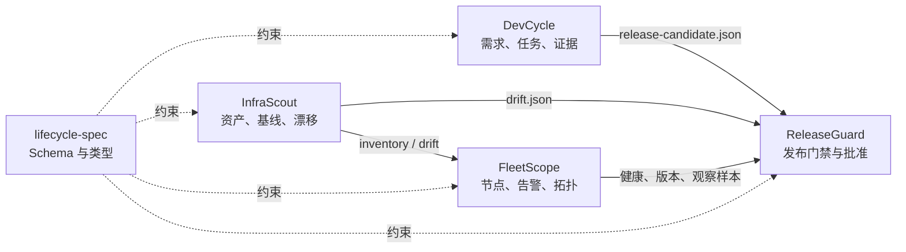
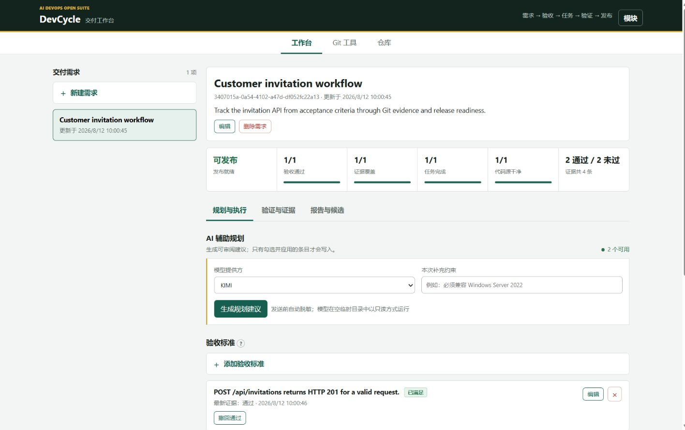
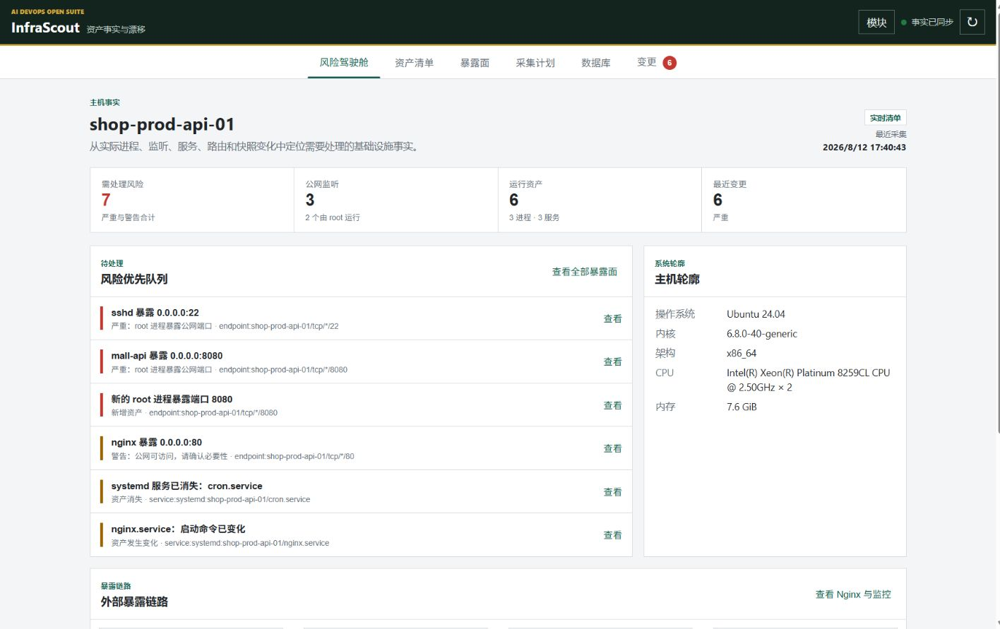
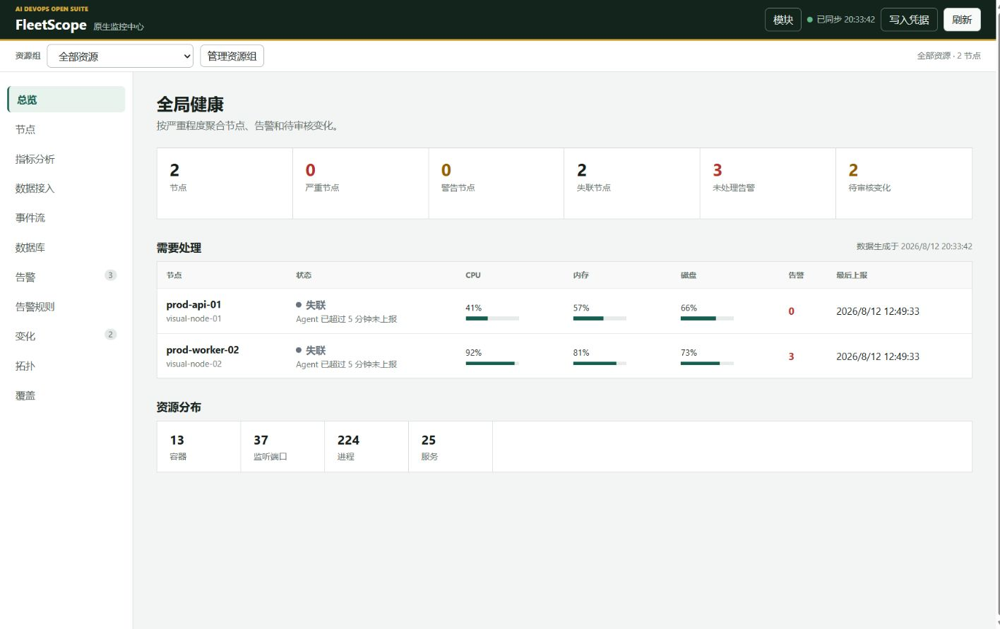
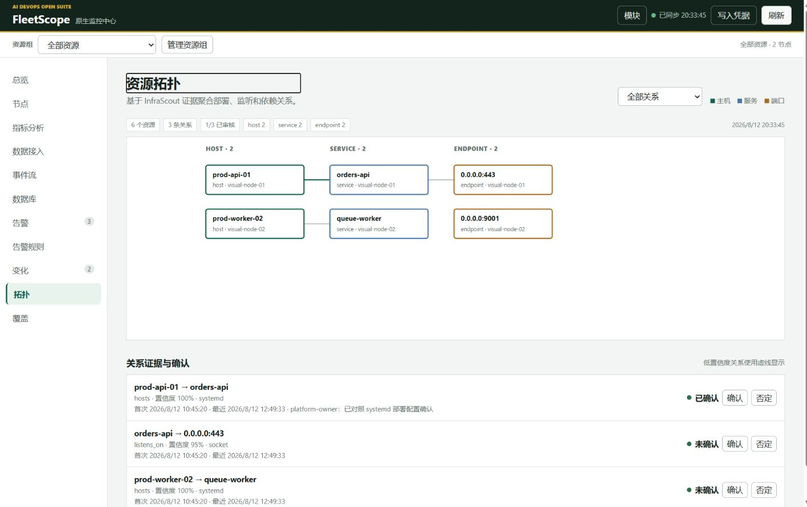
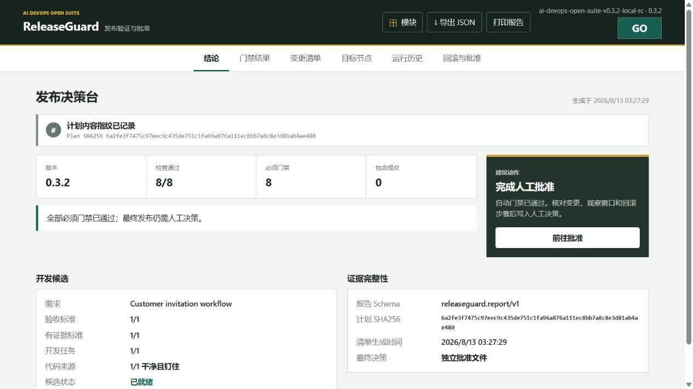

# AI DevOps Open Suite

本地优先、可独立部署的开源开发运维套件。它把“为什么改、改了什么、机器实际运行什么、发布能不能继续”连接成一条带证据的链路。

AI 是可选执行者，确定性采集、稳定 ID、显式规则和人工批准才是事实来源。

## 三分钟启动

从 [Releases](https://github.com/GeneJie199/ai-devops-open-suite/releases) 下载并解压当前套件包，然后执行一条命令。安装器会按平台下载五个经过 SHA-256 校验的二进制，生成本机 Fleet 凭据、初始化数据目录并启动全部页面。

当前套件版本为 `0.3.3`，默认安装已完成跨平台发布门禁和下载资产复验的 `0.3.2` 产品组件。

Windows PowerShell：

```powershell
.\scripts\install-suite.ps1 -Start
```

Linux 或 macOS：

```bash
./scripts/install-suite.sh --start
```

默认仅监听 `127.0.0.1`。启动后打开 DevCycle 的 `http://127.0.0.1:8766`，顶部模块切换器可进入 InfraScout、FleetScope 和 ReleaseGuard。完整的目录、端口、离线安装和日常管理说明见[快速开始](docs/quickstart.md)。

需要重启后自动恢复时，将安装命令中的 `-Start` 换成 Windows 的 `-EnableAutostart`，或将 `--start` 换成 Linux/macOS 的 `--enable-autostart`。安装后可随时运行 `suitectl doctor` 自检二进制、目录、凭据和端口。

## 五个仓库

| 产品 | 解决的问题 | 可独立使用 |
|---|---|---|
| [DevCycle](https://github.com/GeneJie199/ai-dev-cycle-manager) | 需求、验收、任务、Git Worktree、Codex/KIMI/Claude 会话、验证证据、发布候选 | 是 |
| [InfraScout](https://github.com/GeneJie199/infrastructure-discovery) | Linux/systemd/Docker/Nginx/数据库发现、基线、漂移、风险和离线报告 | 是 |
| [FleetScope](https://github.com/GeneJie199/fleet-observability) | 多节点指标、探针、告警、变化分类、历史趋势、资源组、监控覆盖和资源拓扑 | 是 |
| [ReleaseGuard](https://github.com/GeneJie199/release-validation) | 发布计划、确定性门禁、Git/配置/数据库/Fleet 验证、回滚和人工批准 | 是 |
| [lifecycle-spec](https://github.com/GeneJie199/lifecycle-spec) | 跨模块 JSON Schema、示例、Go/TS 类型和离线校验器 | 是 |

## 完整链路



模块不 import 对方内部包；它们只通过版本化 JSON 和 HTTP 交互，所以可以按需要单独安装。

## 产品界面

### DevCycle 工作台



### InfraScout 风险驾驶舱



### FleetScope 总览与证据拓扑





### ReleaseGuard 发布决策台



## 能力边界

当前版本面向个人、小团队和内网小中型节点集，提供：

- 单文件 Go 二进制和嵌入式 Web UI；运行时不需要 Node 或外部 CDN。
- SQLite、原子 JSON，以及 FleetScope 自研的分段时序/事件存储。
- loopback 默认、InfraScout 脱敏、Fleet 写入认证、TLS/mTLS、不可变发布证据。
- Linux/macOS/Windows 构建，CI、发布工作流、校验安装、持久端口和免管理员自启动。
- 跨五模块自动 E2E：候选 → 基线/漂移 → Agent 上报 → Fleet 观察 → ReleaseGuard `GO`。

明确不声称：

- 替代代码编辑器、Kubernetes 控制面或企业 IAM。FleetScope 本身覆盖默认采集与有界时序存储，不要求另行部署 Prometheus 或其他采集器；Prometheus、Influx 和 OTLP 只是兼容输入。
- 自动修复机器、自动合并代码、自动上线或替人做最终批准。
- 在没有计划覆盖和证据的情况下证明业务绝对正确。

## 本地验收

将 `ai-devops-open-suite` 与 `lifecycle-spec`、`ai-dev-cycle-manager`、`infrastructure-discovery`、`fleet-observability`、`release-validation` 克隆到同一父目录，然后在 `ai-devops-open-suite` 仓库根目录执行：

Windows：

```powershell
.\scripts\verify-suite.ps1
```

Linux、macOS、WSL 或 Git Bash：

```bash
./scripts/verify-suite.sh
```

成功条件包括五个 Go module 的测试与 vet、五个二进制构建、协议 Schema 校验、DevCycle readiness、InfraScout 证据、Fleet Agent 真实上报和 ReleaseGuard 多次观察后的 `GO`。

## 设计原则

1. **本地优先**：默认不把源码、资产和证据发往第三方。
2. **AI 可替换**：Codex/KIMI/Claude 只是本机执行器，业务状态不绑定厂商。
3. **变化必须有证据**：验收、漂移和发布都能回到命令、文件、报告或人工记录。
4. **人工保留决策权**：工具给建议和失败原因，人决定批准、基线和回滚。
5. **稳定契约**：跨仓数据走 `lifecycle-spec`，0.x 变更通过 Schema、示例和兼容测试演进。

## 安全

- 所有 Web 服务默认监听 loopback；远程访问优先 SSH 隧道或认证反向代理。
- ReleaseGuard 计划可以执行命令，必须像部署代码一样评审。
- 数据库 DSN、Fleet Token 和 TLS 私钥只通过环境/文件配置，不进入仓库示例的真实值。
- Inventory、Git 报告和 Agent 日志仍可能包含运维元数据，外发前需复核。

每个仓库都包含 `SECURITY.md`、`CONTRIBUTING.md`、Apache-2.0 `LICENSE` 和更具体的运维说明。

## 项目资料

- [v1.0 总控计划](V1_MASTER_PLAN.md)
- [当前项目状态](PROJECT_STATUS.md)
- [公开路线图](ROADMAP.md)
- [兼容性矩阵](COMPATIBILITY.md)
- [平台支持矩阵](SUPPORT_MATRIX.md)
- [发布政策](RELEASE_POLICY.md)
- [安装与快速开始](docs/quickstart.md)
- [v0.4.0-dev 安装生命周期验收](docs/checkpoint-v0.4.0-dev.md)
- [0.3.3 套件发布审计](docs/release-0.3.3.md)
- [0.3.2 发布审计](docs/release-0.3.2.md)
- [架构与立项草案](docs/plan-v0.1.md)
- [0.3.1 稳定版发布审计](docs/release-0.3.1.md)
- [0.3.0 RC.2 发布审计与稳定版门禁](docs/release-0.3.0-rc.2.md)
- [命名和文档审计](docs/naming-and-doc-audit.md)
- [原生可观测架构决策](docs/native-observability-architecture.md)
- [早期 Linux 扫描里程碑](docs/next-feature-linux-scan-demo.md)

维护者：[GeneJie199](https://github.com/GeneJie199)。
